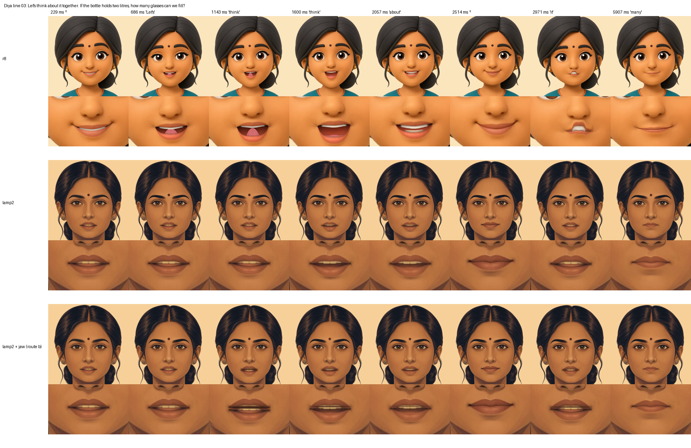
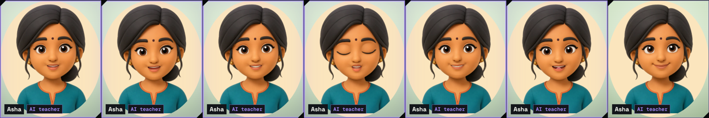
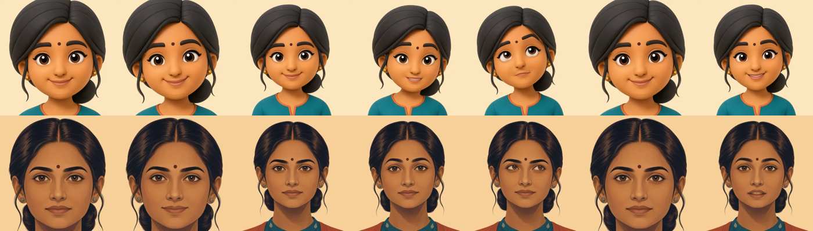

# Asha's face: what needs your decision (round 7)

This page collects every face decision that is waiting on you, with the evidence for each, so you can decide in one
sitting. All numbers were measured in a desktop browser (headless Chromium, software GL), not on a phone. What only a
real phone can show is in section 5.

**The four decisions**

| # | Decision | Options | Recommendation |
|---|---|---|---|
| A | **Her look** (OWNER.md row 3) | r8 (today's default) · lamp2 · lamp2 + jaw | See section 1. It is your call on looks; the measured numbers favour lamp2 + jaw over lamp2. |
| B | **Daily greeting clips** (27 short lines, Azure voice) | Approve the spend (a few cents) · not now | Approve. Without the clips she greets Home silently: a glance at Start, no voice. |
| C | **Painted pose stills** (wave, reading, watering, telescope) | Approve the Azure image spend (small) · keep the stand-ins | Approve after decision A, so they are painted in the chosen look. |
| D | **A real low-end phone pass** | Someone runs the 12-check list on a ₹8–10k Android | Needed before any child uses the live face. It needs the Azure keys and a deployed revision. |

## 1. Her look: r8, lamp2 or lamp2 + jaw

*One spoken line (Diya's voice, "Let's think about it together…"), sampled at the same moments, in the three looks.
Each look shows the full face, then the mouth up close.*

| | r8 | lamp2 | lamp2 + jaw |
|---|---|---|---|
| **What it is** | Cartoon mesh rig (WebGL) | Painted portrait, mouth shapes swapped as painted keys (Canvas 2D) | lamp2, plus a lower lip and chin layer that drops smoothly with her speech |
| **Who sees it today** | Everyone (the default) | Only your account (owner cohort), once it is re-keyed | Your account with `?jaw=1` |
| **Reads as** | Young, round, big eyes | A grown-up teacher | A grown-up teacher whose mouth visibly opens more |
| **Mouth timing** (drawn mouth vs the voice; the bar is −125 … +45 ms) | median −5 ms, **89%** of replies within ±50 ms (real lesson page, n = 46, Oct 2026) | median +5 ms, **67%** of lines within ±50 ms; worst −320 / +235 ms (24-line battery) | median −20 ms, **100%** of lines within ±50 ms (same 24-line battery) |
| **Lips close on b / m / p** (132 such words in the battery) | 123/132 with its current rule | **132/132** | **132/132** |
| **Weak phones** | Has the light mouth (still + 4 painted mouths) where the rig can't run | No live-rig gate needed (2D is cheap) | Same as lamp2 |

**What the sheet shows.** r8's mouth opens wide and clearly (teeth, tongue) but she looks like a child. lamp2 looks
like a grown-up teacher, but her mouth moves very little: across the line it barely leaves a slight parting. The jaw
layer adds a visible drop on open vowels ("think", "about") and still closes fully on b / m / p.

**What follows from each choice**
- **r8:** nothing to change. The "one grown-up Asha" goal stays open.
- **lamp2 or lamp2 + jaw:** we make it the default look (`TAXILA_FACE_LOOK`) after the real-phone pass (section 5).
  Then her stills, the parent badge and the light mouth are re-rendered in that look (no Azure spend: they come from
  the live rig).
- **Also possible, independent of the look:** r8 could take lamp2's b / m / p rule (the 9 missed words: "dhoop",
  "carbon", "about", "tum", "lagbhag", "खुशबू", "Shabash", "Ab", "vaashpikaran"). It is a small change, but it is not
  measured on r8 yet.

To try it yourself: sign in with your re-keyed account, open a lesson, then add `?jaw=1` to the URL for the jaw.

## 2. Daily greeting clips (spend)

Once a day, after the child's first tap on Home, she says one short line (27 lines across English, Hindi and Hinglish,
morning, afternoon and evening; no child's name; no gendered Hindi verbs). Her lips follow the clip. The strip above
uses the existing Hello clip as a stand-in.

The spend renders the 27 lines once in Diya's voice: `scripts/character/render-greetings.mjs`, then the lip-sync
sidecars, which cost nothing. Without the clips she greets Home silently, with a glance at Start.

Lip-sync on pre-rendered clips (her b / m / p seals with the sidecar vs without it): English 6/6 (2/6 without),
Hindi 15/15 (5/15), Hinglish 12/13 (5/13). Overall 33/34, up from 12/34.

## 3. Painted pose stills (spend)

Cards, the parent view and the home use stills rendered from the live face, so a card and a lesson are the same
person. Seven poses come from the rig (portrait, smile, resting, listening, thinking, curious, proud). Four need
hands or props, so for now a rig still stands in for each: wave → smile, reading → thinking, watering → resting,
telescope → curious. The spend paints those four in the chosen look. Decide the look (section 1) first.

## 4. Already done (no decision needed)

- **One Asha on every path.** A failure (no WebGL, a slow phone, the kill switch) holds her own still and never swaps
  her to another face (`r7-face-fallback-sheet.png`).
- **Weak phones.** Phones that can't draw the live face get her still with a light mouth instead
  (`lite-mouth-strip.png`).
- **The lesson start is not slowed by the face.** The face draws off the main thread. Start → her first sound is
  +102 ms against the face switched off (target ≤ +300 ms), and the lesson's face is already moving before she speaks
  (`handoff-start.json`).
- **The young band's teach-back helper** sits beside her (`protege-moods-sheet.png`).

## 5. What only a real phone can tell us

Everything above is from a desktop browser. Before any child sees the live face, someone runs
[needs-live-low-end-phone.md](needs-live-low-end-phone.md) (12 checks) on a ₹8–10k Android. It needs the Azure keys
(OWNER.md row 1) and a deployed revision. The three checks that matter most:

1. **Does the weak-phone gate choose right?** (live face vs the still with a light mouth)
2. **Is her face up before she speaks after Start, without delaying her first sound?**
3. **Does it hold up through a 15-minute lesson** (no step-downs from heat, and it recovers after switching apps)?
