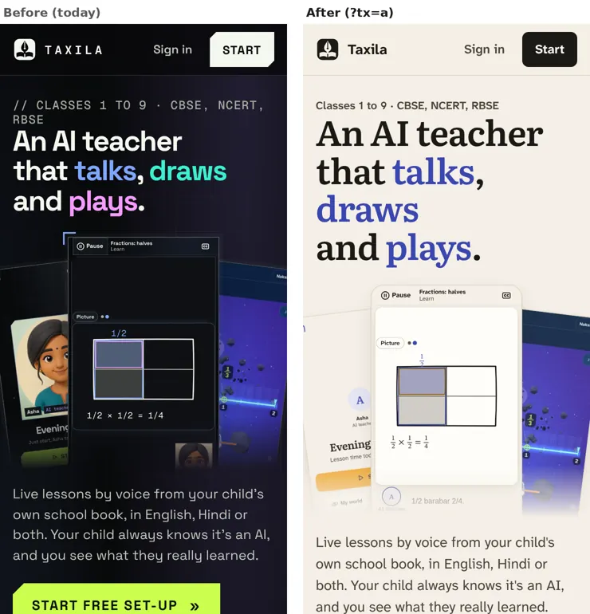
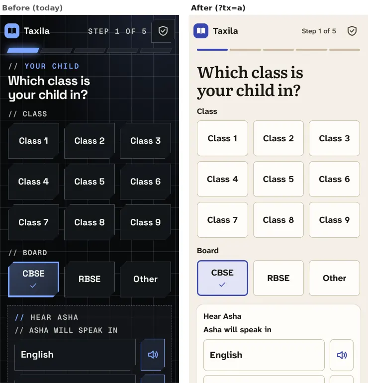
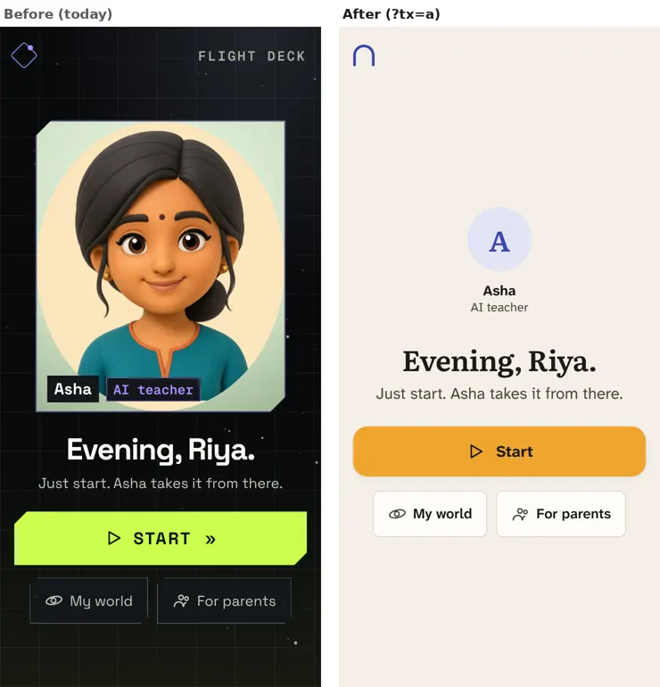
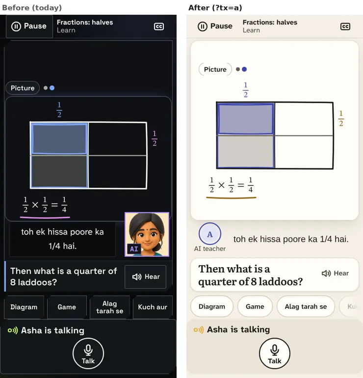
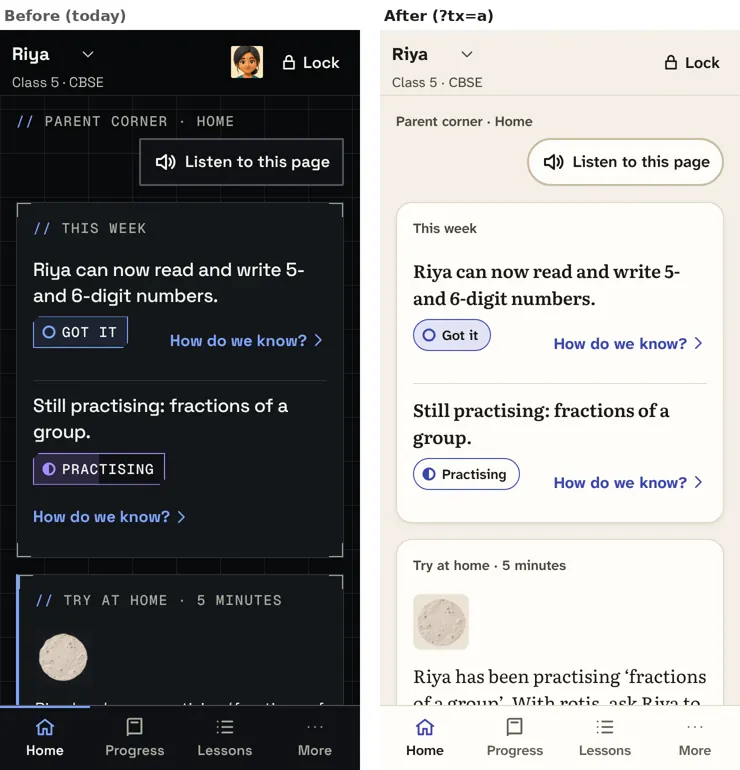
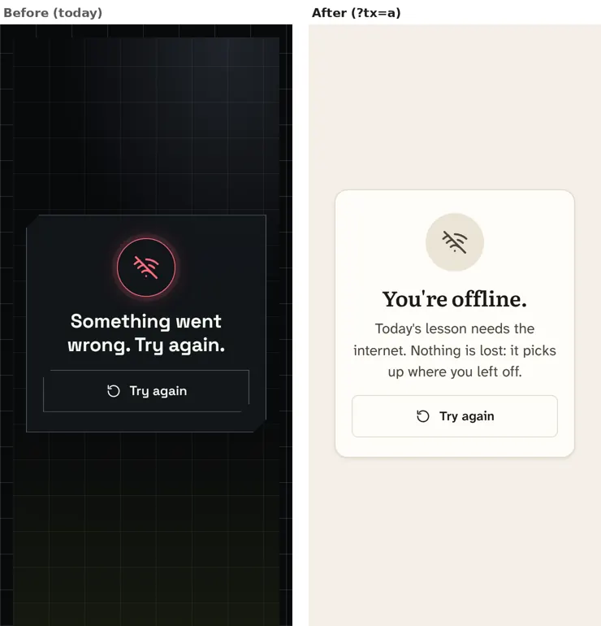

# The new look: before and after

How to see it on your phone or laptop:
- **Paper and ink, the new default:** open **taxila.dev/?tx=a**. The device remembers the choice on every page.
- **The night version:** **?tx=b**.
- **Back to today's look:** **?tx=off**.

Nothing changes for anyone else until you say so. Each pair below shows today on the left and the new look on the right, as they look on a phone.

## 1. The front page

The dark, grid-lined "control panel" page is now a calm paper page, and the pictures on it show the new lesson screen.

## 2. Set-up

Choosing the class and board reads like a clear, friendly form, without slanted tiles, code-style labels or glowing edges.

## 3. The child's home

The home has her name, a simple circle and "AI teacher" in place of the cartoon face. One honest line sits under the greeting (here, the questions waiting from last time), with one big Start.

## 4. A lesson

The board is now a large sheet of paper. Her words sit beside her circle, and the question is the second biggest thing on the screen. The face no longer covers the board.

## 5. The parent corner

The corner reads like a well-set letter about your child, with no terminal capitals or corner brackets. The "Got it" and "Practising" marks are soft labels.

## 6. When the internet is off

"Something went wrong" in alarm red is now a calm "You're offline. Nothing is lost". The app also tries again by itself when the connection returns.

---

**More detail** (every screen, both versions, phone and laptop):
- `walk/` has the full set of screens.
- `README.md` has the step-by-step notes.

**Not in the new look yet:** the games, and the drawn boards' last colour values. Both are with the people building them.
